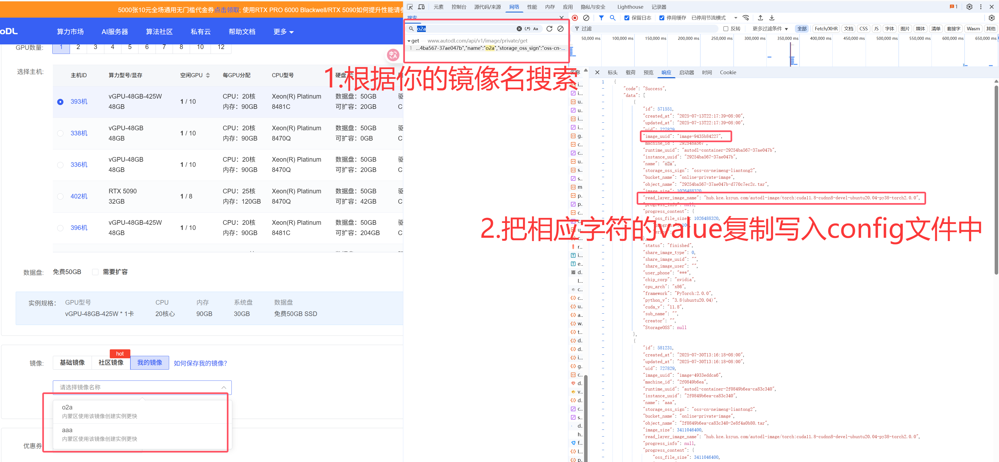
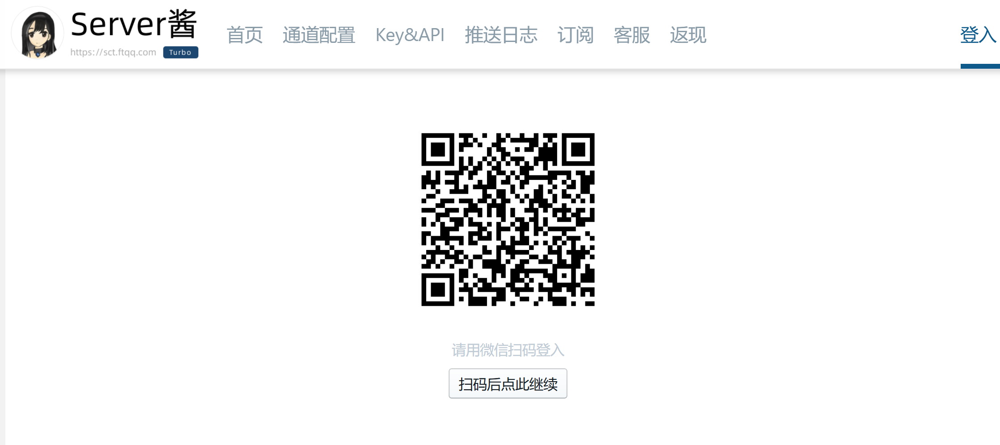
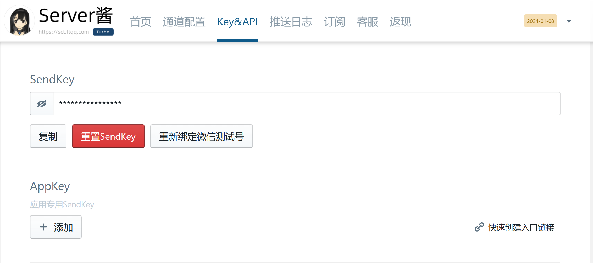

# AutoDL GPU 自动监控工具

> 🚀 一个智能的 AutoDL 平台 GPU 资源监控和自动购买工具

本项目专为 AutoDL 平台设计，能够自动监控空闲 GPU 资源，并在满足条件时自动购买启动实例。特别适用于需要抢占稀缺 GPU 资源的深度学习任务场景。

## ✨ 核心功能

- 🔍 **智能监控**: 同时监控多个 GPU 型号和指定区域
- ⚡ **自动购买**: 发现可用资源时自动下单购买
- 📱 **即时通知**: 支持 Server酱 微信推送通知
- 🎯 **精准配置**: 支持多种 GPU 型号、数量和镜像配置
- 🔐 **安全登录**: 支持手机号密码登录和微信扫码登录
- 🎮 **双模式运行**: 监控模式 vs 监控+购买模式

## 🚀 快速开始

### 环境准备

项目使用 [uv](https://docs.astral.sh/uv/) 管理 Python 和依赖，固定使用 Python 3.12。

```bash
# macOS 可使用 Homebrew 安装 uv
brew install uv

# 根据 uv.lock 创建 .venv 并安装依赖
uv sync --locked
```

### 快速运行

```bash
uv run --locked python main.py
```

运行无网络单元测试：

```bash
uv run --locked python -m unittest discover -s tests -v
```

新增或删除依赖时分别使用 `uv add 包名` 和 `uv remove 包名`，并将更新后的 `pyproject.toml` 与 `uv.lock` 一起提交。

> 💡 首次运行如果没有配置 `authorization`，程序会自动引导你完成登录流程

## ⚙️ 配置详解

项目使用 JSON 格式的配置文件，所有参数都在 `config.json` 中定义。以下是完整的配置说明：

### 📋 配置模板

```json
{
  "authorization": "",
  "mode": "monitor_only",
  "gpu": {
    "models": ["RTX 3090", "RTX 4090", "RTX 4090D"],
    "num": 1,
    "regions": ["内蒙B区", "重庆A区"]
  },
  "image": {
    "private_image_uuid": "",
    "autodl_image": "hub.kce.ksyun.com/autodl-image/torch:cuda12.4-cudnn-devel-ubuntu22.04-py312-torch2.5.1"
  },
  "notification": {
    "sendkey": ""
  }
}
```

仓库还提供不含凭据的 `config.example.json`。请将自己的 Authorization 和 SendKey 只保存在本地，不要提交到公开仓库。

### 🔧 参数详解

#### 🔑 authorization
- **功能**: AutoDL 平台授权令牌，用于 API 认证
- **类型**: `string`
- **获取**: 首次运行时程序会自动引导登录获取
- **说明**: 留空时会触发自动登录流程

#### 🎮 mode
- **功能**: 程序运行模式
- **类型**: `string`
- **选项**: 
  - `"monitor_only"` - 👀 仅监控模式（发现资源时通知但不购买）
  - `"monitor_and_buy"` - 💰 监控购买模式（发现资源时自动购买）
- **默认**: `"monitor_only"`
- **推荐**: 测试时使用 `monitor_only`，确认无误后切换到 `monitor_and_buy`

#### 3. gpu 对象
##### 3.1 models
- **说明**: 要同时监控和购买的 GPU 型号，数组顺序就是抢购优先级
- **类型**: 非空字符串数组
- **可选值**: 
  - **RTX 系列**: `"RTX 5090"`, `"RTX 4090"`, `"RTX 4090D"`, `"RTX 3090"`, `"RTX 3080*2"`, `"RTX 3080 Ti"`, `"RTX 3080"`, `"RTX 3060"`, `"RTX 2080 Ti *2"`, `"RTX 2080 Ti"`, `"RTX A4000"`
  - **GTX 系列**: `"GTX 1080 Ti"`
  - **专业卡系列**: `"V100-32GB"`, `"V100-SXM2-32GB"`, `"A100-PCIE-40GB"`, `"A100-SXM4-80GB"`, `"A800-80GB"`, `"H800"`, `"H20-NVLink"`, `"L20"`, `"L40"`, `"A40"`, `"Tesla T4"`
  - **虚拟GPU**: `"vGPU-32GB"`, `"vGPU-48GB"`
  - **其他**: `"TITAN Xp"`, `"CPU"`, `"CPU-close-HT"`, `"910B2x鲲鹏920"`
- **示例**: `["RTX 3090", "RTX 4090", "RTX 4090D"]`
- **兼容**: 旧配置 `"model": "RTX 3090"` 仍可使用；如果 `models` 和 `model` 同时存在，以 `models` 为准

##### num - GPU 数量
- **功能**: 指定购买的 GPU 卡数
- **类型**: `integer`
- **范围**: 1-8（根据 GPU 型号限制）
- **示例**: `1` (单卡), `4` (四卡并行)

##### regions - 区域
- **功能**: 限制只在指定区域监控和购买，数组顺序是同一型号下的区域优先级
- **类型**: 非空字符串数组
- **可选值**: `"内蒙B区"`, `"重庆A区"`, `"西北B区"`, `"北京B区"`, `"北京A区"`, `"佛山区"`, `"内蒙A区"`, `"L20专区"`, `"3090专区"`, `"V100专区"`, `"A800专区"`, `"华为昇腾专区"`
- **示例**: `["内蒙B区", "重庆A区"]`
- **兼容**: 不配置时，自动合并各目标型号原有的默认区域

程序每轮对每个区域只查询一次。当多种型号同时有货时，按照 `models` 顺序、再按照 `regions` 顺序尝试；某个候选被其他用户抢走后会继续尝试同轮的下一个候选。成功创建一个实例后程序立即退出，不会继续购买第二个实例。

仅监控模式会把同轮发现的全部可用型号和区域合并到一条通知中，然后退出。

#### 🐳 镜像配置

##### private_image_uuid - 私有镜像
- **功能**: 使用自定义私有镜像
- **类型**: `string`
- **获取**: AutoDL 控制台 → 镜像管理 → 查看镜像 UUID
- **示例**: `"image-4933eddca6"`
- **说明**: 优先使用私有镜像，为空则使用公共镜像

##### autodl_image - 公共镜像
- **功能**: 指定 AutoDL 官方镜像
- **类型**: `string`

**🔥 推荐镜像**:
| 框架版本 | 镜像地址 | 适用场景 |
|----------|----------|----------|
| PyTorch 2.5.1 | `hub.kce.ksyun.com/autodl-image/torch:cuda12.4-cudnn-devel-ubuntu22.04-py312-torch2.5.1` | 最新版本 |
| PyTorch 2.3.0 | `hub.kce.ksyun.com/autodl-image/torch:cuda12.1-cudnn-devel-ubuntu22.04-py312-torch2.3.0` | 稳定版本 |
| PyTorch 2.1.2 | `hub.kce.ksyun.com/autodl-image/torch:cuda11.8-cudnn8-devel-ubuntu22.04-py310-torch2.1.2` | 兼容性好 |

**📸 镜像选择指南**:

<details>
<summary>🖼️ 如何选择公共镜像</summary>


1. 进入 AutoDL 控制台
2. 选择"创建实例"
3. 在镜像选择中找到对应版本
4. 复制镜像地址到配置文件

</details>

<details>
<summary>🔒 如何使用私有镜像</summary>



1. 进入 AutoDL 控制台
2. 点击"我的镜像"
3. 找到目标镜像的 UUID
4. 复制到 `private_image_uuid` 字段

</details>

#### 📱 通知配置

##### sendkey - Server酱推送
- **功能**: 微信消息推送服务
- **类型**: `string`
- **格式**: `SCT123456xxxxxxxxxxxxx`
- **获取方式**: [Server酱官网](https://sct.ftqq.com/) 注册获取
- **说明**: 为空时跳过消息推送

**🔔 通知设置指南**:

<details>
<summary>📱 如何获取 Server酱 SendKey</summary>



</details>


本项目部分代码与实现思路参考了 [autogpu](https://github.com/lemonmindyes/autogpu) 和 [Jiayi-Fu/autodl-gpu-monitor](https://github.com/Jiayi-Fu/autodl-gpu-monitor) 项目，感谢两位原作者的开源贡献与启发。

---

<div align="center">
